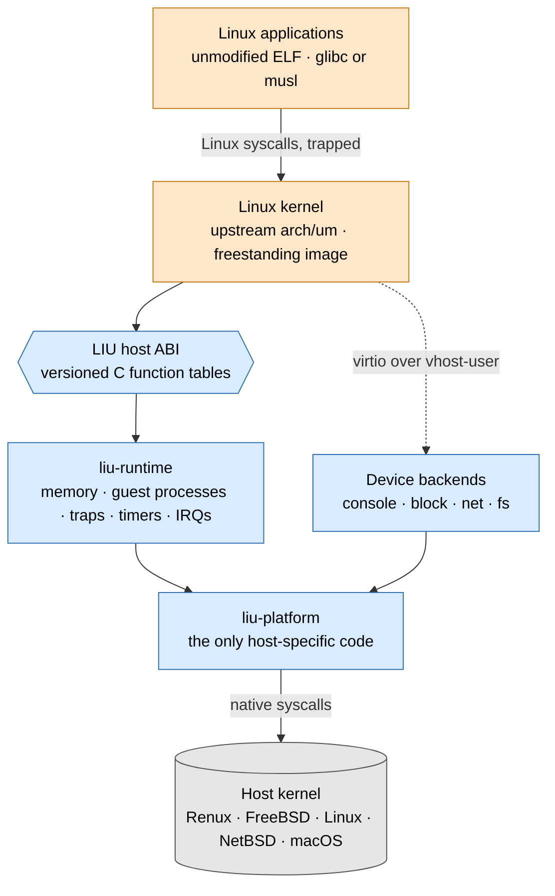

<div align="center">

# LIU

### Linux In Userspace

**A real Linux kernel, running as an ordinary process.**<br>
Built for [Renux](https://github.com/renuxproject/renux). Portable to every Unix.

[](https://github.com/Renan2010p/liu/actions/workflows/ci.yml)
[](LICENSE)


[Architecture](docs/architecture.md) ·
[Decisions](docs/adr/) ·
[Style](docs/style.md) ·
[Contributing](CONTRIBUTING.md)

</div>

---

LIU loads an unmodified upstream Linux kernel into user space and runs Linux
applications **on that kernel**. The host only lends it the hardware: memory,
CPU time, timers, interrupts and devices, through a small, versioned host ABI
written in Rust.

Nothing is translated. A Linux program talks to Linux, so `io_uring`, eBPF,
namespaces, cgroups, `systemd`, containers and Flatpak's sandbox work because
the kernel that implements them is really there.



<sub>Orange: Linux, GPL-2.0, C. Blue: LIU, MPL-2.0, Rust. Grey: the host.</sub>

## Why not the linuxulator?

FreeBSD's linuxulator, which Renux inherits, translates every Linux system call
into a native one inside the host kernel. It is fast, but it can only ever be as
complete as its translation, and it puts Linux code into the host kernel.

| | linuxulator | **LIU** | Virtual machine |
|---|:---:|:---:|:---:|
| Who implements Linux | host kernel, by translation | **the real Linux kernel** | the real Linux kernel |
| `io_uring`, eBPF, namespaces, cgroups | missing or partial | **yes** | yes |
| Linux code in the host kernel | yes | **none** | none |
| Needs VT-x or root | no | **no** | yes |
| Runs inside a jail | yes | **yes** | no |
| Cost | low | **a trap per syscall, native otherwise** | VM exits, fixed RAM |

## Where it runs

LIU needs an x86_64 Unix that can stop a process at a system call and keep the
host from executing it. Renux is the reference platform; the rest is reached
through `liu-platform`.

| Tier | Hosts | Trap mechanism |
|:---:|---|---|
| **1** | **Renux** | `PT_SET_SC_RET`, one stop per call |
| **1** | FreeBSD | rewrite at entry, fix at exit |
| **1** | Linux | `PTRACE_SYSEMU` |
| 2 | NetBSD · DragonFly · macOS (Intel) | `PT_SYSCALLEMU` · ptrace · Hypervisor.framework |
| 3 | OpenBSD · illumos · arm64 hosts | research |

## Status

LIU is in its first milestones. **It does not run Linux programs yet.**

| | Milestone | |
|:---:|---|---|
| ✅ | **M0** Foundation | ABI, ELF loader, platform layer, CI on Linux and FreeBSD |
| 🔨 | **M1** Runtime | load a freestanding test kernel, serve the ABI |
| | **M2** Guest processes | trap backends on every Tier 1 host |
| | **M3** Linux boots | `init=/bin/sh` from an initramfs |
| | **M4** Devices | root filesystem and console over virtio |
| | **M5** Usable system | Arch, Fedora or Alpine with networking |
| | **M6** Performance | `trapvec`, KVM |
| | **M7** More hosts | NetBSD, macOS, GUI and Flatpak apps |

The details are in the [roadmap](docs/architecture.md#16-roadmap).

## Building

```sh
git clone https://github.com/Renan2010p/liu.git
cd liu
cargo build --workspace
cargo xtask ci
```

`cargo xtask ci` runs the style check, clippy, the tests (which exercise the
running kernel: ptrace, Capsicum, shared memory), the C header check and a
compile-time check for Linux. On Renux it also verifies `PT_SET_SC_RET`.

```text
$ cargo test -p liu-platform -- --nocapture
host: Renux (FreeBSD 15.1-RELEASE-p6) (amd64), trap backends: [RenuxSetScRet, FreeBsdRewrite]
```

## Repository

```text
crates/
  liu-abi/        host ABI: tables, registers, traps, status codes   no_std
  liu-elf/        ELF64 parser and kernel image load planner         no_std
  liu-platform/   probing, shared memory, processes, ptrace, sandbox
kernel/           Linux side; generated include/liu/host.h           GPL-2.0
xtask/            gen-header · check-abi · style · ci
docs/             architecture, decisions, style
```

## LIU and Renux

LIU is designed with Renux and for Renux. The proposal in
[ADR 0007](docs/adr/0007-liu-as-a-renux-component.md) makes it an official Renux
component, delivered as a package, while the base system stays built by Zig
alone and free of Linux code.

## License

LIU is licensed under the [Mozilla Public License 2.0](LICENSE), like Renux.
The Linux kernel and everything under `kernel/` that derives from it are
GPL-2.0-only. See [licensing](docs/architecture.md#17-licensing).
