# LIU Architecture

| | |
|---|---|
| **Status** | Draft, revision 2 |
| **Scope** | Host runtime, host ABI, platform layer, kernel port, devices, build, roadmap |
| **Supersedes** | The Phase 0 prototype (`liu` repository, commit `73410a5`) |
| **License** | MPL-2.0 for LIU code; GPL-2.0-only for the Linux kernel and its patches |

## Contents

1. [Summary](#1-summary)
2. [Goals and non-goals](#2-goals-and-non-goals)
3. [Lessons from the Phase 0 prototype](#3-lessons-from-the-phase-0-prototype)
4. [Key design decisions](#4-key-design-decisions)
5. [Execution model](#5-execution-model)
6. [Host ABI](#6-host-abi)
7. [Platform layer and trap backends](#7-platform-layer-and-trap-backends)
8. [Devices](#8-devices)
9. [Kernel side](#9-kernel-side)
10. [Rust workspace](#10-rust-workspace)
11. [Command line and configuration](#11-command-line-and-configuration)
12. [Security model](#12-security-model)
13. [Performance model](#13-performance-model)
14. [Renux kernel primitives](#14-renux-kernel-primitives)
15. [Testing strategy](#15-testing-strategy)
16. [Roadmap](#16-roadmap)
17. [Licensing](#17-licensing)
18. [Risks and open questions](#18-risks-and-open-questions)
19. [LIU and Renux](#19-liu-and-renux)

---

## 1. Summary

LIU (**Linux In Userspace**) runs an unmodified, real Linux kernel as an
ordinary unprivileged process on Renux and on other Unix systems: FreeBSD,
Linux, NetBSD and macOS among them. Linux applications run *on that kernel*,
not on the host: their system calls are serviced by real Linux code. The host
provides only the "hardware" — memory, CPU time, timers, interrupts and devices
— through a small, versioned, Linux-agnostic **host ABI** implemented in Rust.

This is the opposite of the FreeBSD linuxulator, which translates each Linux
system call into a native one inside the host kernel and so leaves many
interfaces missing or stubbed (`io_uring`, `bpf`, namespaces, cgroups,
`pidfd_*`, `userfaultfd`, `fanotify`, ...). LIU translates nothing at the
syscall level. It virtualizes the machine underneath Linux, so every interface
the Linux kernel supports is available, and the host kernel carries no Linux
code.

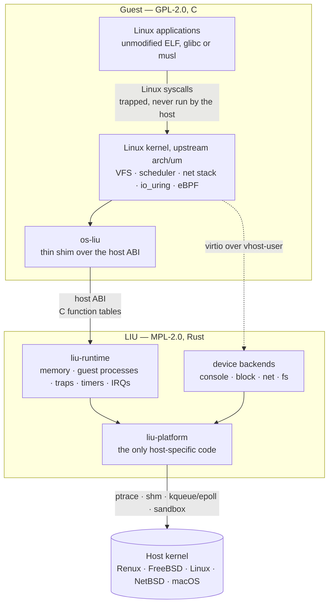

## 2. Goals and non-goals

### Goals

1. Run unmodified Linux binaries against a **real** Linux kernel on Renux and
   other Unix hosts.
2. Keep the Renux kernel free of Linux-specific code. Any kernel support LIU
   needs must be a generic, independently useful primitive.
3. Write every component LIU authors in **Rust**, and keep the unavoidable C
   (code that lives inside the Linux tree) small and mechanical.
4. Run unprivileged and confined: no root, no kernel module, sandboxed.
5. Track an upstream Linux LTS release with a small, rebasable patch series.
6. **Portability.** Run on any Unix host that offers a way to intercept a
   process's system calls. Host-specific code is confined to the platform
   layer; the kernel image, the host ABI and the device backends are identical
   on every host.

### Non-goals

- Reimplementing the Linux syscall surface (the gVisor approach).
- Translating Linux syscalls into host syscalls (the linuxulator approach).
- Hardware virtualization as a requirement. bhyve already covers that; LIU must
  work without VT-x and inside jails.
- Graphics acceleration in the first releases.

## 3. Lessons from the Phase 0 prototype

The prototype proved the concept and found exactly where it broke. This design
is shaped by those results.

| Finding | Consequence |
|---|---|
| A real UML 6.12 kernel boots on a real Linux host, and a Rust guest benchmark runs inside it. | The execution model is sound. Keep `arch/um`. |
| Booting under the linuxulator fails: `PTRACE_SYSEMU` is missing and `PTRACE_POKEUSER` is broken there. | Never depend on a host's Linux emulation. Use native host primitives only. |
| `PT_SET_SC_RET` was added to the Renux kernel as a generic ptrace request and verified. | This is the trap primitive of the Renux backend. It is generic and stays. |
| `arch/x86/um/user-offsets.c` and `os-Linux` collide with FreeBSD libc headers; a dozen shims were needed. | Stop compiling Linux host code against the host libc. |
| The natively built UML binary aborts before `main`: the UML linker script is incompatible with the FreeBSD C runtime. | Stop linking the kernel as a host libc program. Load it ourselves. |
| The host-side C port (`os-Renux`) grew into many files of libc emulation. | Move host logic into Rust behind a narrow ABI; the C side only forwards. |

The central change: **the Linux kernel becomes a freestanding image loaded and
hosted by a Rust runtime**, instead of a host executable linked against libc.

## 4. Key design decisions

Each decision has an [ADR](adr/).

| # | Decision | ADR |
|---|---|---|
| D1 | Run the real Linux kernel in user space, based on upstream `arch/um`. | [0001](adr/0001-real-linux-kernel-in-userspace.md) |
| D2 | Build the kernel freestanding; a Rust runtime loads it and serves it through C function tables. | [0002](adr/0002-freestanding-kernel-rust-runtime.md) |
| D3 | Devices are vhost-user backends in separate Rust processes, driven by the upstream `virtio_uml` driver. | [0003](adr/0003-devices-via-vhost-user.md) |
| D4 | Guest syscall trapping sits behind a `TrapBackend` trait. | [0004](adr/0004-pluggable-trap-backends.md) |
| D5 | Renux kernel changes must be generic primitives with no Linux knowledge. | [0005](adr/0005-no-linux-code-in-renux.md) |
| D6 | LIU is portable through a platform layer; Renux is the reference platform with runtime-detected fast paths. | [0006](adr/0006-portable-platform-layer.md) |
| D7 | LIU is an official Renux component, delivered as a package, outside the Zig-built base system. *(proposed)* | [0007](adr/0007-liu-as-a-renux-component.md) |

## 5. Execution model

### 5.1 Processes

A running LIU instance is a small tree of ordinary host processes:

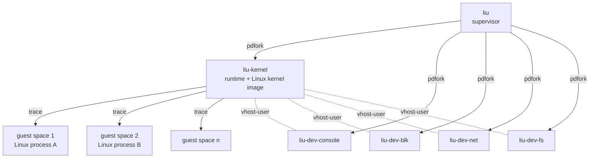

- **Supervisor** (`liu`): reads the configuration, opens every host resource,
  creates the shared memory and device sockets, spawns everything with process
  descriptors, and owns lifecycle and logging. It never runs guest code.
- **Kernel process** (`liu-kernel`): the Rust runtime with the Linux kernel image
  mapped into the same address space. Linux kernel code runs here.
- **Guest spaces**: one host process per Linux `mm_struct` (or one vCPU address
  space with the `hvf` and `kvm` backends). Linux user code runs here. Every
  system call it makes is trapped and handed to the Linux kernel.
- **Device backends**: one process per device, each holding exactly the
  resource it serves (a disk image, a directory, a network descriptor).

### 5.2 Guest physical memory

Guest "physical" RAM is one anonymous shared memory object, created by the
platform layer (§7.5) and mapped by everyone who needs it. No page is ever
copied across the boundary.

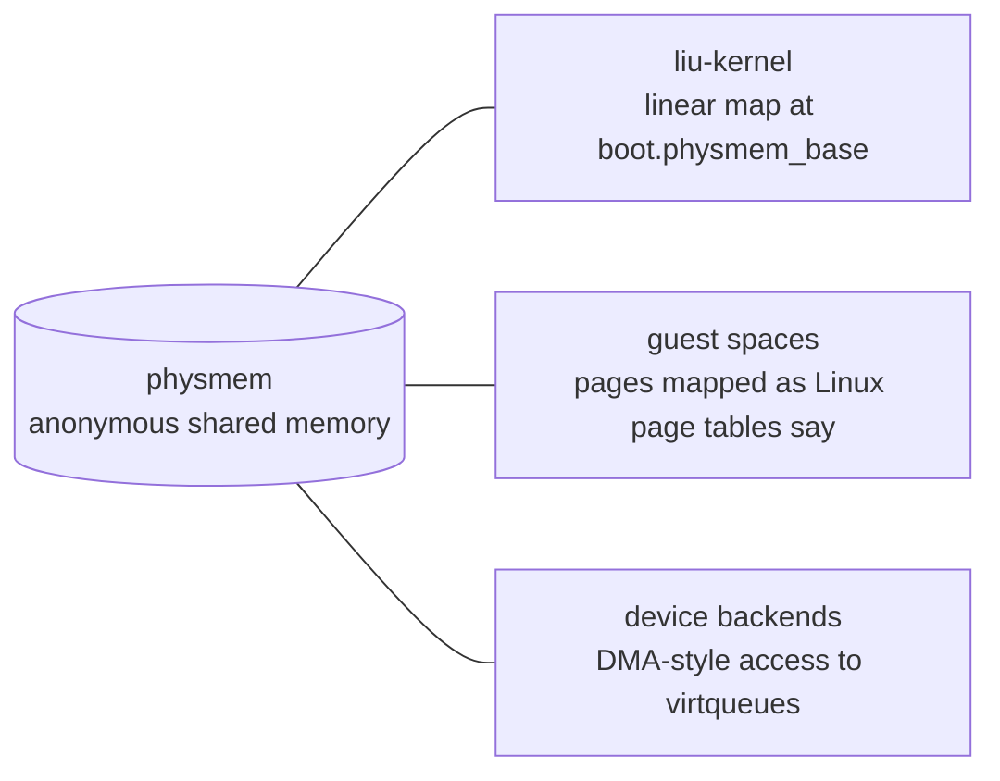

In the kernel process the layout is fixed: the image at its link address
(`0x60000000`, as arch/um), physmem after it, then the `kmap` window, each
2 MiB aligned. The window is reserved inaccessible at start-up and is the
only place `kmap` maps, so the kernel can never replace runtime memory.

A page fault in a guest space becomes a trap. Linux resolves it in its own page
tables, and the runtime applies the resulting mapping in the guest space.

### 5.3 Guest address-space operations

Mapping changes inside a guest space are performed by a small **stub** mapped
at a fixed address in every guest process, as in upstream UML. The runtime
queues `mmap`, `munmap` and `mprotect` requests in the stub's shared data page
and resumes the stub, which executes them natively and traps back. Batching
keeps the number of context switches per `execve` or `mmap` low.

The stub is a few hundred bytes of position-independent code written in
`no_std` Rust and embedded in the runtime.

### 5.4 System call path

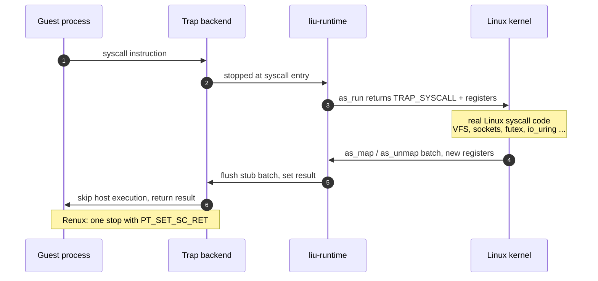

### 5.5 Kernel threads, interrupts and time

- The Linux kernel runs uniprocessor on one **vCPU host thread**. SMP comes later.
- Host events (timers, device kicks, console input) are collected by an **event
  thread** using the platform event loop.
- The event thread records pending interrupts in a lock-free bitmap and signals
  the vCPU thread. The runtime's handler calls `kernel_ops.irq()`, which enters
  Linux's interrupt path the way UML does for `SIGIO` and `SIGALRM` today.
- The Linux kernel never calls `sigaction`, `timer_create`, `kqueue` or `epoll`
  itself. It asks the runtime through the host ABI.
- Until M3, interrupts are delivered only at safe points (`irq_enable`,
  `irq_restore`, the return from `idle`) and the timer needs no event thread
  ([ADR 0008](adr/0008-interrupts-at-safe-points.md)).

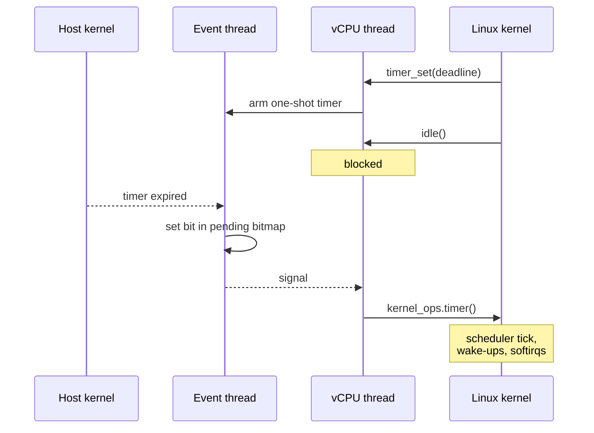

## 6. Host ABI

The host ABI is the only interface between Linux and the host. It is defined
once, in Rust, in `crates/liu-abi`; the C header
`kernel/os-liu/include/liu/host.h` is generated from it with `cbindgen` and
never edited by hand. `cargo xtask check-abi` compiles a C program against the
header and verifies that every size, alignment, field offset and constant
matches the Rust definitions.

### 6.1 Shape

Two function tables are exchanged at entry:

```c
/* SPDX-License-Identifier: MPL-2.0 OR GPL-2.0-only */
struct liu_host_ops;    /* kernel -> runtime: services the host provides */
struct liu_kernel_ops;  /* runtime -> kernel: entry points Linux registers */

/* ELF entry point of the freestanding kernel image. */
liu_status liu_kernel_entry(const struct liu_host_ops *host,
                            struct liu_kernel_ops *kernel,
                            const struct liu_boot_info *boot);
```

Every table begins with a header:

```rust
#[repr(C)]
pub struct TableHeader
{
    pub magic: u32,      // b"LIU\0"
    pub abi_major: u16,  // incompatible changes
    pub abi_minor: u16,  // additive changes
    pub size: u32,       // size of the table as its producer compiled it
    pub reserved: u32,
}
```

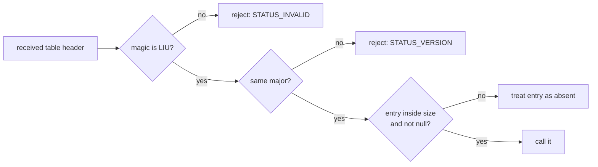

New entries are appended at the end and raise the minor version; an older peer
simply does not see them.

### 6.2 `liu_host_ops`

The authoritative definition is `crates/liu-abi/src/host_ops.rs`.

| Group | Operations | Notes |
|---|---|---|
| **console** | `log_write`, `panic` | Early boot output. `panic` does not return. |
| **kernel memory** | `kmap`, `kunmap`, `kprotect` | Map physmem ranges at kernel-chosen addresses inside the window `boot.kmap_base`/`kmap_size` (ABI 0.2), never elsewhere; W+X is refused. Physmem itself is mapped at `boot.physmem_base` before entry. |
| **address spaces** | `as_create`, `as_destroy`, `as_map`, `as_unmap`, `as_protect`, `as_flush` | Changes are batched until `as_flush` or `as_run`. |
| **execution** | `as_run`, `as_get_fpu`, `as_set_fpu` | Run guest user code until the next trap. TLS bases are part of `GuestRegs`. |
| **cpu** | `irq_enable`, `irq_disable`, `irq_save`, `irq_restore`, `idle` | `idle` blocks the vCPU until an interrupt is pending. |
| **time** | `clock_monotonic`, `clock_realtime`, `timer_set`, `timer_cancel` | Nanoseconds; tickless one-shot deadline. |
| **stacks** | `kstack_alloc`, `kstack_free` | Stacks for Linux kernel threads. |
| **random** | `get_random` | Host entropy. |
| **devices** | `dev_connect`, `chan_send`, `chan_recv`, `event_create`, `event_signal`, `irq_bind`, `handle_close` | `dev_connect` takes a device *name* from the supervisor configuration, never a path. Handles travel out of band. |

Rules:

- Status codes are plain `i32` values from a fixed list (`STATUS_*`). Host
  `errno` values never cross the boundary.
- Pointers are kernel virtual addresses in the kernel process. Guest user
  memory is reached only through physmem.
- No operation names a file path, a socket address or a Linux structure.
- Rust enums never cross the boundary; values received from the other side are
  validated integers.

### 6.3 `liu_kernel_ops`

| Entry | Called when |
|---|---|
| `irq(pending)` | the event thread raised one or more interrupts |
| `timer()` | the one-shot deadline expired |
| `kernel_fault(addr, access, ip)` | a fault occurred in kernel code |
| `shutdown(reason)` | the supervisor requests a power-off or reboot |

Guest traps are not callbacks: they are the result of `as_run`, which keeps the
control flow identical to UML's `userspace()` loop.

### 6.4 Trap events

```rust
#[repr(C)]
pub struct TrapEvent
{
    pub kind: u32,      // TRAP_SYSCALL, TRAP_PAGE_FAULT, TRAP_SIGNAL, TRAP_EXITED
    pub signo: u32,     // TRAP_SIG_* (LIU's own numbering) for TRAP_SIGNAL
    pub access: u32,    // ACCESS_READ | ACCESS_WRITE | ACCESS_EXEC for faults
    pub reserved: u32,
    pub addr: u64,      // faulting address
    pub code: u64,      // syscall number, or exit status
}
```

Registers are not part of the event: `as_run` updates the caller's `GuestRegs`
in place.

## 7. Platform layer and trap backends

### 7.1 Portability model

Everything above the platform layer is host-independent:

- The kernel image is a freestanding ELF that links against no host library and
  uses the System V AMD64 calling convention, which every x86_64 Unix shares.
  The same image runs on every host.
- The host ABI, the device protocol and the device backends are identical on
  every host.

Everything host-specific lives in `liu-platform`. No other crate may use
`#[cfg(target_os = ...)]`.

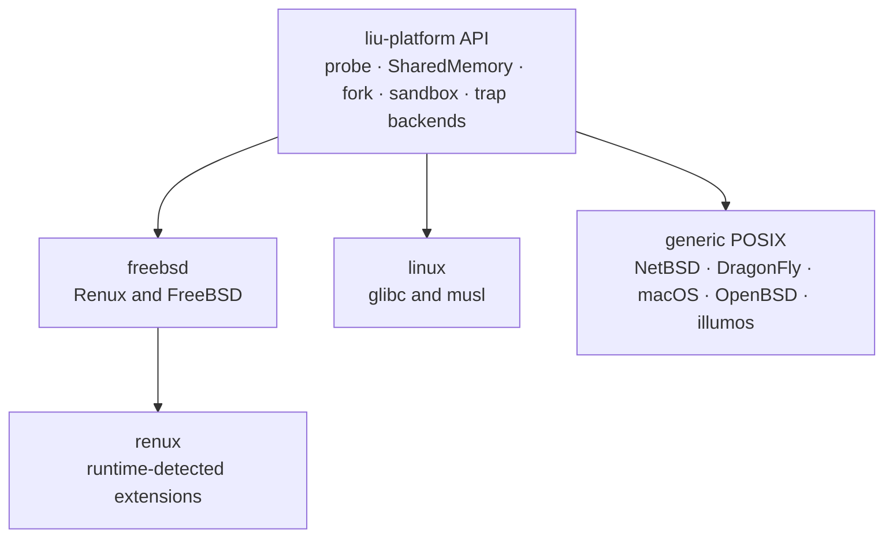

Implemented in M0: `probe`, `SharedMemory`, `fork` with process descriptors,
the Capsicum sandbox, FreeBSD ptrace wrappers and the Renux `PT_SET_SC_RET`
primitive. M2 adds the trap backends, behind trait objects so the runtime
never names a host (`crates/liu-platform/src/trap.rs`):

```rust
pub trait TrapBackend
{
    fn
    kind(&self) -> TrapBackendKind;

    fn
    create_space(&mut self) -> io::Result<Box<dyn GuestSpace>>;
}

pub trait GuestSpace
{
    /// Resume with `regs` (after a syscall trap, `rax` is the Linux result)
    /// and return the next trap with `regs` updated.
    fn
    run(&mut self, regs: &mut GuestRegs) -> io::Result<TrapEvent>;
}
```

`liu_platform::open_trap_backend(&caps)` returns the fastest implemented
backend for the host.

### 7.2 Choosing a trap backend

`liu_platform::probe()` runs once at startup and lists what the host offers,
fastest first. A Renux kernel is detected as FreeBSD plus extensions, so one
FreeBSD build of LIU uses the Renux fast path whenever it runs on Renux.

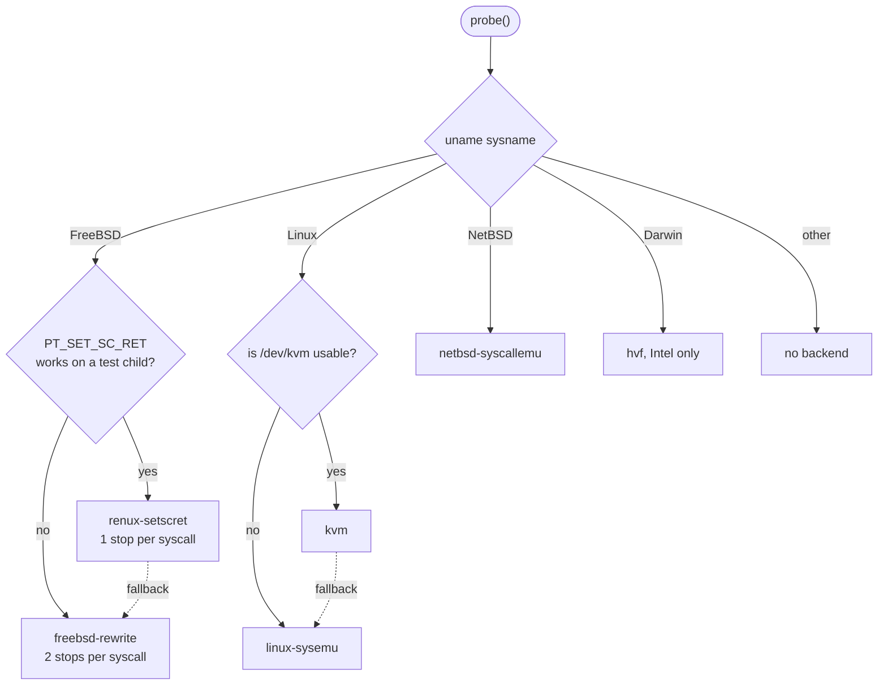

### 7.3 Host requirements

A host can run LIU when it is **x86_64** and offers:

1. a way to stop a process at system call entry, read and write its registers,
   and **prevent the host from executing the call**;
2. shared memory that can be mapped into several processes;
3. a readiness-based event mechanism.

Every modern Unix meets 2 and 3. Requirement 1 decides the trap backend.

### 7.4 Trap backends

| Backend | Hosts | Mechanism | Stops per syscall | Status |
|---|---|---|:---:|---|
| `renux-setscret` | Renux | `PT_TO_SCE`; `PT_SETREGS` with the Linux result, then `PT_SET_SC_RET` with `EJUSTRETURN` skips the call and leaves every register as set | 1 | ✅ M2, 6.6 µs per call |
| `freebsd-rewrite` | FreeBSD, DragonFly | `PT_TO_SCE`, rewrite the call to a harmless one, `PT_TO_SCX`, set the result with `PT_SETREGS` | 2 | M2 |
| `linux-sysemu` | Linux | `PTRACE_SYSEMU`, as upstream UML | 1 | M2 |
| `netbsd-syscallemu` | NetBSD | `PT_SYSCALL` + `PT_SYSCALLEMU` | 1 | M7 |
| `hvf` | macOS (Intel) | Hypervisor.framework runs only guest user code in ring 3; `syscall` exits to the runtime | 0 | M7 |
| `kvm` | Linux | the same through `/dev/kvm`, as gVisor's KVM platform | 0 | M6 |
| `trapvec` | Renux | generic Renux syscall redirection to a supervisor through shared memory | 0 | M6 |

On FreeBSD-family hosts the tracer never sees the page-fault error code
(`PT_GETREGS` zeroes `r_err`), so `renux-setscret` derives the access type:
a fault inside the instruction at `rip` is a fetch, `SEGV_ACCERR` is a write,
`SEGV_MAPERR` is a read. A write to an absent page therefore takes two faults
(read, then write after Linux maps it read-only). A Renux kernel that fills
`r_trapno`/`r_err` would make it exact, and the backend already uses them
when present.

`trapvec` must stay Linux-agnostic: it delivers raw register state and never
interprets syscall numbers, so it is useful to any user-space emulator or
sandbox (D5).

### 7.5 Support tiers

| Tier | Meaning | Hosts |
|:---:|---|---|
| **1** | Built and tested in CI on every change; release blocker | Renux, FreeBSD, Linux (x86_64) |
| **2** | Built in CI; tested before releases | NetBSD, DragonFly, macOS on Intel |
| **3** | Research; no guarantees | OpenBSD, illumos, any arm64 host |

Known limits:

- **arm64 hosts** (Apple Silicon, Raspberry Pi, Ampere) need an arm64 port of
  `arch/um`, which does not exist upstream. Only `GuestRegs` and the trap
  backends are architecture-specific in LIU itself.
- **OpenBSD**'s `ptrace(2)` has no system call stops.
- **macOS**'s `ptrace(2)` cannot read registers; `hvf` is the only route and
  needs the `com.apple.security.hypervisor` entitlement (ad-hoc signing is
  enough).

### 7.6 Other host differences

| Concern | Renux / FreeBSD | Linux | NetBSD | macOS |
|---|---|---|---|---|
| Physmem object | `shm_open(SHM_ANON)` | `memfd_create` | `shm_open` + unlink | `shm_open` + unlink |
| Event loop | `kqueue` | `epoll` | `kqueue` | `kqueue` |
| Device kick | `eventfd` | `eventfd` | `eventfd` | pipe pair |
| Process handle | `pdfork` | `pidfd` | pid | pid |
| Sandbox | Capsicum, jail | Landlock + seccomp | best effort | `sandbox_init` |
| Network, default | user-mode NAT | user-mode NAT | user-mode NAT | user-mode NAT |
| Network, optional | `tap(4)` | TUN/TAP | `tap(4)` | `vmnet` |

## 8. Devices

LIU reuses the upstream `virtio_uml` driver (`arch/um/drivers/virtio_uml.c`),
which carries virtio over the **vhost-user** protocol. Devices are therefore
ordinary vhost-user backends, each a separate Rust process.

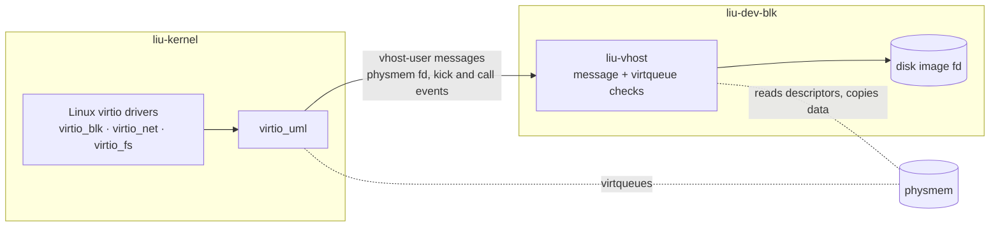

| Backend | Linux driver | Resource |
|---|---|---|
| `liu-dev-console` | `virtio_console` | stdio or a pseudo-terminal |
| `liu-dev-blk` | `virtio_blk` | raw image file, ZFS zvol or memory disk |
| `liu-dev-net` | `virtio_net` | user-mode NAT (default, unprivileged); host TAP device (optional) |
| `liu-dev-fs` | `virtio_fs` or 9p | one directory descriptor; nothing outside it is reachable |
| `liu-dev-rng` | `virtio_rng` | host entropy |

The device boundary is the I/O security boundary: a compromised Linux kernel can
only send vhost-user messages and virtqueue descriptors to backends that check
every descriptor against the physmem bounds.

## 9. Kernel side

The C that LIU maintains (GPL-2.0-only) is a patch series against a pinned
Linux LTS tree:

```text
kernel/
  VERSION                     pinned upstream version (6.12.y LTS)
  patches/
    0001-um-add-os-liu-host-layer.patch
    0002-um-freestanding-build-mode.patch
    0003-um-x86-user-offsets-without-host-headers.patch
  configs/
    liu_defconfig             UP, virtio_uml, no hostfs, no host libc drivers
  os-liu/
    host.c                    os_* functions forwarding to liu_host_ops
    entry.c                   liu_kernel_entry, table registration
    include/liu/host.h        generated from liu-abi, never edited
```

- `os-liu` implements the existing `os_*` contract of `arch/um` by forwarding to
  `liu_host_ops`. It contains no policy and no libc calls.
- The kernel is built with `-ffreestanding -nostdlib`, linked with a LIU linker
  script, and exports only `liu_kernel_entry`. The host libc and C runtime are
  out of the build, which removes both Phase 0 blockers.
- UML drivers that need host libc (`hostfs`, `ubd`, `net_user`) are disabled;
  vhost-user devices replace them.
- Patches stay small and are rebased on each LTS point release.

## 10. Rust workspace

```text
liu/
├── crates/
│   ├── liu-abi/          host ABI types, tables, status codes          no_std  ✅
│   ├── liu-elf/          ELF64 parser and kernel load planner          no_std  ✅
│   ├── liu-platform/     the only host-specific code                           ✅
│   │   └── src/{freebsd/, linux/, generic.rs}
│   ├── liu-physmem/      bounds-checked guest physical memory access          ✅
│   ├── liu-trap/         guest stub and host-independent trap handling
│   ├── liu-runtime/      kernel process: loader, host_ops, vCPU, events          ✅
│   ├── liu-vhost/        vhost-user protocol and virtqueues
│   ├── liu-dev-*/        device backends: console, blk, net, fs, rng
│   ├── liu-config/       instance configuration
│   └── liu/              supervisor and CLI
├── kernel/               Linux patch series and os-liu               GPL-2.0
├── xtask/                gen-header · check-header · check-abi · style · ci  ✅
├── tests/                integration and boot tests
└── docs/
```

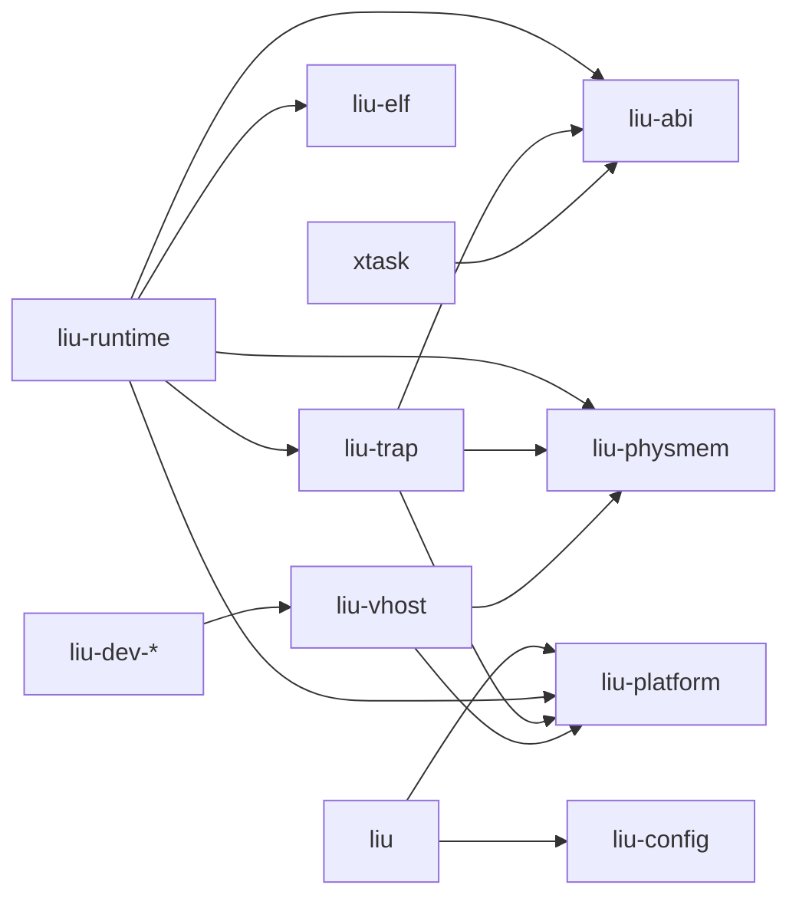

Rules:

- `unsafe` is allowed only in `liu-platform`, `liu-physmem`, `liu-trap` and the
  `host_ops` glue of `liu-runtime`. Other crates use `#![forbid(unsafe_code)]`.
  `tests/abi-kernel` plays the kernel side and is exempt, like the C in `kernel/`.
- `#[cfg(target_os = ...)]` is allowed only in `liu-platform`.
- `liu-abi` and `liu-elf` are `no_std`, so the stub and test kernels can use them.
- All Rust code follows [KNF](style.md).

## 11. Command line and configuration

```sh
liu run --kernel linux.liu --rootfs arch.img -- /bin/bash
liu run --config instance.toml
liu ps
liu stop arch
```

```toml
[instance]
name = "arch"
memory = "2G"

[kernel]
image = "/usr/local/share/liu/linux.liu"
cmdline = "root=/dev/vda rw console=hvc0"

[[device]]
kind = "blk"
path = "/var/liu/arch.img"

[[device]]
kind = "net"            # user-mode NAT unless `tap = "tap0"` is given

[[device]]
kind = "fs"
tag = "home"
path = "/home/renan"
read_only = false
```

## 12. Security model

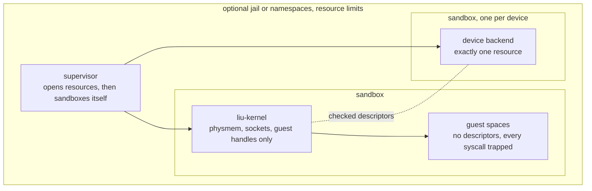

| Layer | Mechanism |
|---|---|
| Supervisor | Opens every host resource up front, passes descriptors, then enters the platform sandbox. |
| Kernel process | Platform sandbox (Capsicum on Renux/FreeBSD; Landlock + seccomp on Linux). Holds physmem, device sockets and guest handles; cannot open paths or sockets. |
| Guest spaces | Every syscall is trapped. Even with a trap-backend bug they hold no descriptors and run sandboxed. |
| Device backends | One sandbox each, with exactly one resource. Every descriptor is checked against physmem bounds. |
| Instance | Optionally a jail (Renux/FreeBSD) or namespaces (Linux), with resource limits. |

A Linux kernel compromise yields an unprivileged, sandboxed host process. It
cannot reach the host kernel through any Linux-specific code path, because none
exists. Sandbox strength depends on the host: strongest on Renux, FreeBSD and
Linux; best effort elsewhere.

## 13. Performance model

| Path | Crosses to the host? | Cost driver |
|---|---|---|
| CPU-bound guest code | no | native speed |
| Syscall served from Linux caches (`getpid`, cached `read`, pipes, futex) | trap only | trap backend round trip |
| Page fault, `mmap` | trap + stub batch | number of mapping changes |
| Block and network I/O | virtqueue kick | device rate, batched |
| Timer | none between deadlines | one-shot deadlines |

Every milestone records syscall round-trip latency, page-fault latency,
`fork` + `exec` time, boot-to-shell time and memory overhead. The Phase 0
reference (≈404 µs per `getpid`) ran under TCG emulation and is not
representative; bare-metal numbers on each Tier 1 host are a milestone
deliverable.

## 14. Renux kernel primitives

LIU needs no Renux-specific kernel support to run: stock FreeBSD is a supported
host. The primitives below are Renux fast paths, detected at runtime, and all
are generic (D5).

| Primitive | Used by | Status |
|---|---|---|
| `PT_SET_SC_RET` (ptrace request 45: skip the syscall, set its result) | `renux-setscret` | In the Renux tree (`renuxproject/renux` commit `cb1ed96`); verified on the running kernel |
| `trapvec`: syscall redirection to a supervisor through shared memory | `trapvec` | Design (M6) |

## 15. Testing strategy

| Level | What | Where |
|---|---|---|
| Unit | ABI layout and negotiation, ELF validation, style rules | `cargo test` ✅ |
| Platform | shared memory, processes, Capsicum, `PT_SET_SC_RET` on the running kernel | `crates/liu-platform/tests` ✅ |
| ABI drift | regenerate `host.h` and fail on diff; compile a C probe and compare every offset | `cargo xtask check-header`, `check-abi` ✅ |
| ABI conformance | a freestanding Rust test kernel that calls every `host_ops` entry | `cargo xtask test-abi` ✅ |
| Trap backends | hand-assembled Linux code in a guest space: syscalls, errors, faults, TLS | `crates/liu-platform/tests/trap_renux.rs` ✅ (Renux only) |
| Boot | boot `liu_defconfig` to a busybox initramfs and script a shell session | `cargo xtask test-boot` (M3) |
| Compatibility | selected Linux Test Project suites inside the guest | nightly (M5) |

The test kernel lets the runtime be built and verified without compiling Linux,
which takes hours on the development machine.

## 16. Roadmap

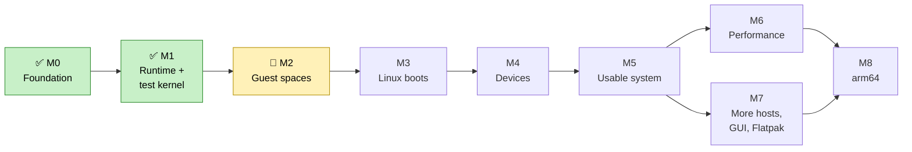

| Milestone | Deliverable | Exit criterion |
|---|---|---|
| **M0 Foundation** ✅ | Workspace, `liu-abi`, `liu-elf`, `liu-platform`, style checker, CI | `cargo xtask ci` passes on Renux, Linux and FreeBSD |
| **M1 Runtime + test kernel** ✅ | `liu-runtime` loads a freestanding test kernel and serves log, memory, time and cpu | ABI conformance suite passes on Renux and Linux |
| **M2 Guest spaces** | `renux-setscret`, `freebsd-rewrite`, `linux-sysemu`; stub; physmem mappings | A static test binary runs in a guest space on every Tier 1 host |
| **M3 Linux boots** | `kernel/` patch series, freestanding `arch/um` build, `os-liu` | `init=/bin/sh` from a busybox initramfs; `uname -a` works |
| **M4 Devices** | `liu-vhost`, console, blk, rng | Root filesystem on `/dev/vda`; console on `hvc0` |
| **M5 Usable system** | net, fs, supervisor CLI, sandboxing everywhere | Arch, Fedora or Alpine boots; the package manager installs over the network |
| **M6 Performance** | `trapvec` and `kvm` backends; SMP study | Measurably faster syscalls than ptrace; published benchmarks |
| **M7 More hosts** | NetBSD, DragonFly, macOS (`hvf`); display bridge (virtio-vsock + waypipe) | Boot test on every Tier 2 host; a Flatpak GUI app opens a window |
| **M8 arm64** | arm64 `GuestRegs`, `arch/um` arm64 study | Feasibility report |

## 17. Licensing

- Code written for LIU is **MPL-2.0**, like Renux. Every Rust file carries
  `// SPDX-License-Identifier: MPL-2.0`.
- The Linux kernel and everything under `kernel/` that derives from it is
  **GPL-2.0-only**.
- The generated `host.h` is `MPL-2.0 OR GPL-2.0-only`, so both sides can include
  it.
- LIU code is not marked "Incompatible With Secondary Licenses", so MPL-2.0 §3.3
  allows distributing the runtime together with the GPL-2.0 kernel image; the
  LIU source files stay available under MPL-2.0.
- Device backends are separate programs speaking vhost-user and stay MPL-2.0.

This describes intent, not legal advice, and should be reviewed before the first
binary release.

## 18. Risks and open questions

| Risk | Mitigation |
|---|---|
| The freestanding `arch/um` build needs more patching than expected | M1 and M2 do not depend on Linux; measure in M3; fall back to linking the runtime into the kernel |
| ptrace trap cost slows syscall-heavy workloads | Stub batching; `trapvec` and `kvm` in M6; stable backend trait |
| Signal-based interrupts interacting with Rust on the vCPU thread | Handlers only set state and enter Linux; no allocation, no locks; covered by the conformance kernel |
| Upstream `arch/um` changes between LTS releases | Pin one LTS; rebase on point releases |
| `virtio_uml` expects Linux `eventfd` semantics | `eventfd` where available, a pipe pair elsewhere, inside `liu-platform` |
| Trap mechanisms differ between hosts | One conformance suite per backend; CI on every Tier 1 host |
| Ptrace-stopped processes ignore `SIGKILL` on FreeBSD | Found in M0; `liu-platform` kills traced children with `PT_KILL` |
| Portability work slows the Renux path | Renux is the reference platform; Tier 2 never blocks Tier 1 |

Open questions:

1. 32-bit (i386) guests: out of scope until M5.
2. SMP: needs `arch/um` SMP in the pinned kernel; evaluate after M5.
3. Graphics: the M7 display bridge gives software-rendered windows; GPU
   acceleration is open.

## 19. LIU and Renux

LIU is a Renux project that also serves other systems. The proposed
relationship ([ADR 0007](adr/0007-liu-as-a-renux-component.md)):

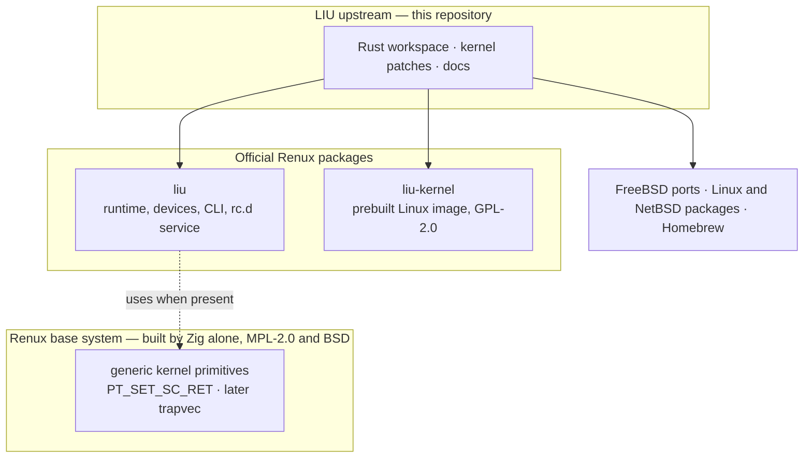

- **The base system keeps only generic primitives.** Renux's base is built by
  Zig alone and carries no Linux code; LIU needs a Rust toolchain and ships a
  GPL kernel image, so it does not belong in the base tree.
- **LIU ships as official Renux packages**: `liu` (runtime, device backends,
  CLI, `rc.d` service) and `liu-kernel` (the prebuilt Linux image).
- **LIU stays one upstream** for every host, so Renux benefits from the testing
  other systems provide, and Renux remains the reference platform.
